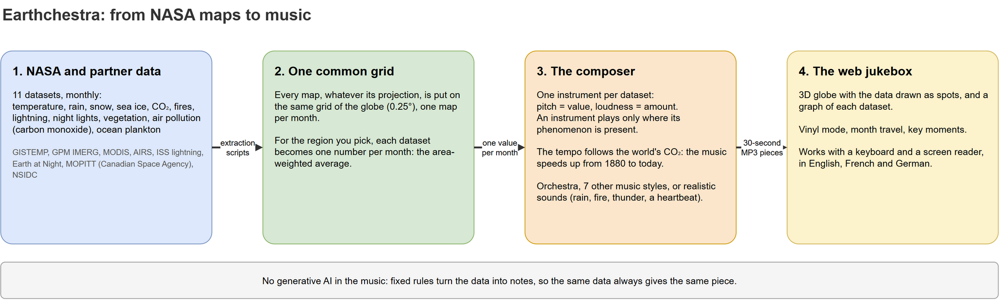

# About the Project

## NASA Space Apps Challenge 2026

Earth Information Jukebox, whose app is called **EarthChestra**, was created for the [NASA Space Apps Challenge](https://www.spaceappschallenge.org/), the world's largest annual global hackathon. The challenge invites innovators, scientists, designers, storytellers, makers, technologists, and others to use open NASA data to create solutions to challenges we face on Earth and in space.

### The Challenge

Our team tackled the challenge of making NASA's Earth Information Center data more accessible. The Earth Information Center provides crucial visualizations about climate change, but these visual representations are inaccessible to millions of people worldwide.

### Our Solution

We transform climate visualizations into **audio** through a process called **sonification**. By mapping data values to musical properties (pitch, volume, instrument), we create an orchestral experience that conveys the same information as visual charts - but through sound.

---

## How It Works

The diagram shows the journey from NASA maps to music in four steps:

- **NASA and partner data**: 11 monthly datasets (temperature, rain, snow, sea ice, CO₂, fires, lightning, night lights, vegetation, carbon monoxide, ocean plankton) are fetched by extraction scripts.
- **One common grid**: every map, whatever its projection, is put on the same 0.25° grid of the globe, one map per month. For the region you pick, each dataset becomes one number per month, the area-weighted average.
- **The composer**: each dataset plays its own instrument. The value sets the pitch, the amount sets the loudness, and an instrument plays only where its phenomenon is present. The tempo follows the world's CO₂, so the music speeds up from 1880 to today. You can hear it as an orchestra, in 7 other music styles, or as realistic sounds (rain, fire, thunder, a heartbeat).
- **The web jukebox**: the result arrives as 30-second MP3 pieces, played under a 3D globe that draws the data, with a graph of each dataset, vinyl mode, month travel and key events. It works with a keyboard and a screen reader, in English, French and German.

There is no generative AI in the music. Fixed rules turn the data into notes, so the same data always gives the same piece. The steps below give the details.

1. **Data preparation**: NASA and partner sources (GISTEMP temperature anomalies, GPM IMERG rain and snow, ISS LIS lightning, Earth at Night lights, MODIS fires, CO2 maps extracted by the team, NSIDC Sea Ice Index, MODIS Terra vegetation index, MOPITT carbon monoxide, MODIS Aqua ocean chlorophyll) are converted by the `data_processing` scripts onto one common 0.25° grid (720×1440), one `.npy` file per month, stored in the `datasets` repository.

2. **Selection**: In the webapp, the user picks a zone on the globe (or in the list view) and enables instrument tracks. The track list comes from `GET /api/instruments`.

3. **Composition**: The webapp sends the zone's points, the enabled tracks and a start month to `POST /api/zones/zone-data`. The backend averages each dataset over the zone and maps values to musical parameters:
   - Temperature anomaly → Piano chords (higher temp = higher pitch)
   - Rain → Violin melody
   - CO2 → Contrabass line
   - Snow, fires, lightning, night lights → Glockenspiel, Trombones, Timpani, Synth pad
   - Sea ice, vegetation, carbon monoxide, ocean plankton → Bowed glass, Clarinet, Bassoon, Vibraphone
   - The tempo of each bar follows the global CO2 of its month, so the music speeds up over the decades

4. **Playback**: The backend returns 30 seconds of MP3 (one bar per month: about 8 months in 1880, 12 to 13 today, as the tempo rises with the CO2) plus the next period to request. The webapp chains the chunks seamlessly, and the globe draws the raw dataset values for the month being played.

---

## Key Features

### Sonification Engine
- Server-side composition and rendering (FastAPI, MIDI, VSCO orchestral samples or SoundFont fallback)
- One instrument per dataset, each scaled on the whole series of the selected zone so the same value always gives the same note
- Datasets with different time coverage are lined up by date; an instrument is silent where its data is missing
- Nine music styles: the orchestra (default), realistic sounds of each phenomenon, and seven genres for fun (ragtime, swing, rock'n'roll, funk, synth-pop, house, trap)

### Accessibility First
- Targets WCAG 2.1 AA
- Full keyboard navigation (Space, arrow keys, Home/End, M)
- Screen reader support with live announcements of the current value
- List view as a non-visual alternative to the globe
- Interface in English, French and German, light and dark themes
- A How to use page that explains each control

### Interactive Exploration
- Select continents, countries, oceans and seas on a 3D globe or in a list
- Enable or disable instrument tracks
- Seek through time, jump to a date, or hear one month year after year
- Play one of 22 key climate events (El Niño, droughts, wildfires, floods, storms, sea ice record lows, the Hunga Tonga eruption)
- Follow a chart of the zone's values, one line per dataset
- Vinyl mode: the globe becomes a record; the needle travels across places, through time, or both
- Watch the raw data of the selected zone drawn on the globe during playback

---

## Technology Stack

| Layer | Technology |
|-------|------------|
| Frontend | React 19, TypeScript, Vite, react-globe.gl (three.js), i18next, Web Audio API (playback) |
| Backend | FastAPI, Python, NumPy |
| Audio | MIDI, VSCO 2 CE orchestral samples, GeneralUser GS SoundFont, MP3 output |
| Data | NASA GISTEMP v4, GPM IMERG, ISS LIS (SVS), Earth at Night (SVS), MODIS (fires, NDVI, chlorophyll), MOPITT, NSIDC Sea Ice Index, CO2 maps |
| Deployment | Docker, Docker Compose |

---

## Open Source

All code is hosted on GitHub under the [The-Earth-Information-Jukebox-HEIG-VD](https://github.com/The-Earth-Information-Jukebox-HEIG-VD) organization.

!!! note
    All repositories are public, but none has a license file yet: the code can be read, not reused.

