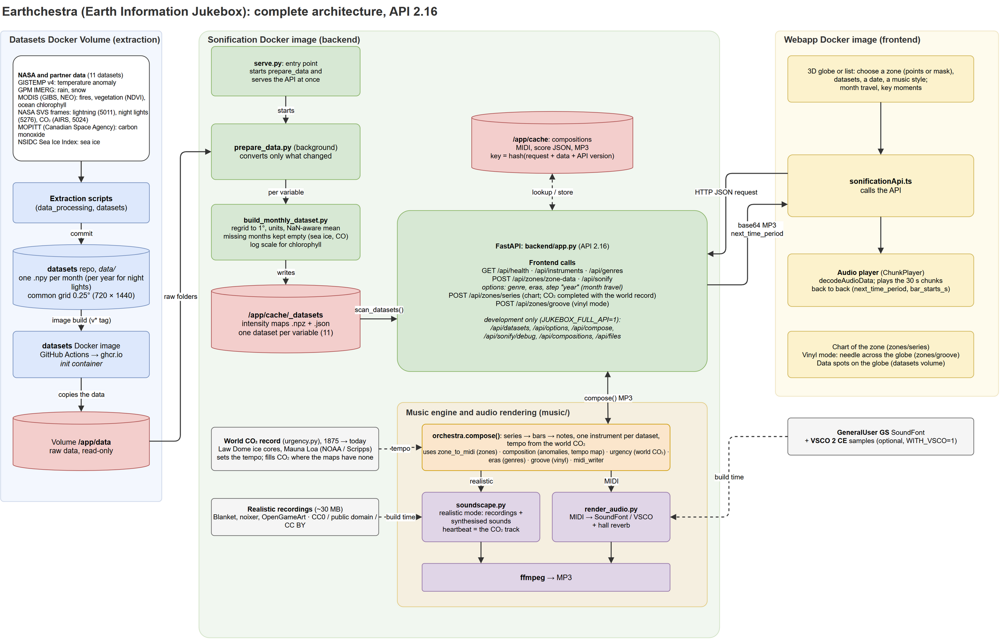

# Development Overview

## Architecture

[](../assets/architecture-technical.png)

*Select the diagram to open it at full size.*

The project runs as three Docker parts, shown as the three columns of the diagram.

**Datasets volume (left).** The extraction scripts (`data_processing`, `datasets`) convert the 11 NASA and partner sources: GISTEMP v4, GPM IMERG, MODIS (GIBS, NEO), the NASA SVS frames for lightning, night lights and CO₂, MOPITT and the NSIDC Sea Ice Index. They are committed to the `datasets` repository as one `.npy` per month (one per year for night lights) on the common 0.25° grid (720 × 1440). A `v*` tag builds the `datasets` Docker image with GitHub Actions and pushes it to ghcr.io. It runs as an init container that copies the data into the read-only volume `/app/data`.

**Sonification image (middle).** `serve.py` starts the API at once and runs `prepare_data.py` in the background. `prepare_data.py` converts only what changed: `build_monthly_dataset.py` regrids each variable to 1°, converts units, takes a NaN-aware mean, keeps missing months empty (sea ice, CO) and uses a log scale for chlorophyll. It writes one dataset per variable to `/app/cache/_datasets`. The FastAPI app (`backend/app.py`, API 2.16) serves the frontend calls (`/api/health`, `/api/instruments`, `/api/genres`, `/api/zones/zone-data`, `/api/sonify`, `/api/zones/series`, `/api/zones/groove`). The development-only endpoints need `JUKEBOX_FULL_API=1`. Finished compositions (MIDI, score JSON, MP3) are cached in `/app/cache`, keyed by a hash of the request, the data and the API version. In the music engine, `orchestra.compose()` turns each series into bars and notes, one instrument per dataset. Its tempo comes from the world CO₂ record (`urgency.py`, Law Dome ice cores and Mauna Loa, 1875 to today), which also fills CO₂ where the maps have no data. `render_audio.py` renders the MIDI with the GeneralUser GS SoundFont, or the optional VSCO 2 CE samples, and adds hall reverb. In realistic mode, `soundscape.py` mixes recordings (CC0, public domain or CC BY) with synthesised sounds, and the heartbeat is the CO₂ track. ffmpeg encodes the result to MP3.

**Webapp image (right).** You choose a zone on the 3D globe or in the list (as points or a mask), the datasets, a date and a music style. `sonificationApi.ts` sends the HTTP JSON request and receives the MP3 as base64 together with `next_time_period`. The audio player (`ChunkPlayer`) decodes the 30 s chunks and plays them back to back, using `next_time_period` and `bar_starts_s`. The zone chart (`zones/series`), vinyl mode (`zones/groove`) and the data spots on the globe (read from the datasets volume) complete the interface.

## System Design

```
┌─────────────────────────────────────────────────────────────────┐
│                      Frontend (React + Vite)                     │
├─────────────────────────────────────────────────────────────────┤
│  ┌──────────────┐  ┌──────────────┐  ┌──────────────────────┐  │
│  │  GlobeView / │  │AudioPlayer-  │  │ TrackPanel           │  │
│  │  ListView    │  │Enhanced      │  │ (inline, aria-exp.)  │  │
│  └──────────────┘  └──────────────┘  └──────────────────────┘  │
│        │                  │                                     │
│        │        ┌─────────┴─────────┐                           │
│        │        │  useSonification  │                           │
│        │        └─────────┬─────────┘                           │
│        │        ┌─────────┴─────────┐                           │
│        │        │    ChunkPlayer    │ ◄── Web Audio API         │
│        │        └───────────────────┘     (decodeAudioData)     │
│  useZoneDataFrames ── reads /data/*.npy (HTTP Range)            │
│  useZoneSeries ────── POST /api/zones/series → SeriesChart      │
└─────────────────────────────────────────────────────────────────┘
         │ /data/                      │ /api (HTTP/JSON)
         │                             │
┌────────┴──────────┐   ┌──────────────┴──────────────────────────┐
│ Datasets volume   │   │            Backend (FastAPI)             │
│ (nginx / Vite dev │   │  GET  /api/health  /api/instruments      │
│  plugin)          │   │  GET  /api/genres                        │
│                   │   │  POST /api/zones/zone-data → 30 s MP3    │
│                   │   │  POST /api/zones/groove → vinyl, 30 s    │
│                   │   │  POST /api/zones/series → monthly values │
└───────────────────┘   │  Music engine composes the music         │
                        └──────────────────────────────────────────┘
```

The browser never synthesizes sound itself: the backend composes and renders the whole orchestra, and the webapp only plays the audio chunks it returns. **There is no offline fallback**: without the backend, no sound is produced and the UI shows a "sound server cannot be reached" error.

See `sonification/backend/FRONTEND_API.md` for the exact contract of the webapp's calls.

---

## Data Flow

1. **Page load** → `useMusicStyle` calls `GET /api/genres` for the Music style menu; `useInstruments` calls `GET /api/instruments?genre=...` (and `/api/health`) to build the track list
2. **User selects a zone** (globe or list) → the zone's grid points are stored; Play becomes available
3. **Play** → `useSonification` → `ChunkPlayer` sends `POST /api/zones/zone-data` with the zone (as a compact `mask` when the browser can build one, else the points), the enabled tracks (`dataset_ids`), a time period, the `genre` and, with one month chosen in **Months**, `step: "year"`
4. **Decode and play** → the response carries 30 s of MP3 (base64), `next_time_period` and `bar_starts_s` (when each month starts: the tempo follows the CO2, so a chunk holds about 8 to 13 months); `ChunkPlayer` decodes it with `decodeAudioData` and plays it
5. **Chaining** → at 20% of the current chunk, the next one is prefetched with `next_time_period`; it is scheduled to start exactly `duration_s` after the previous one (the reverb tail overlaps), so playback is gapless. `next_time_period: null` means the end of the data
6. **Progress updates** → `onProgress` / `onChunk` callbacks → React state → timeline, year display, screen reader announcements
7. **Globe** → during playback, `useZoneDataFrames` reads the raw dataset values of the zone (month by month) from `/data/` and the globe draws them as flowing spots (GPU-instanced discs, size from the value)
8. **Data graph** (when **Graph** is on) → `useZoneSeries` sends `POST /api/zones/series` once for the zone and the enabled tracks; `SeriesChart` draws the whole monthly series on the timeline's axis (the same means the music plays)

Seeking, changing the zone or toggling a track aborts in-flight requests and restarts from the new position.

In **Vinyl** mode a second `ChunkPlayer` (`useVinylSonification`, `services/vinylApi.ts`) plays a record of 10 grooves: in travel Space and Both it sends each groove's path to `POST /api/zones/groove`, in travel Time it chains `POST /api/zones/zone-data` on a small disc around the centre. See [Frontend: Vinyl mode](frontend.md#vinyl-mode).

---

## Sonification Pipeline

```
Selected zone      Backend /api/zones/zone-data Browser
┌─────────────┐   ┌──────────────────────┐    ┌──────────────────┐
│ grid points │   │ aggregate values     │    │ decodeAudioData  │
│ + tracks    │ → │ map to notes, mix    │ →  │ schedule chunk N │
│ + period    │   │ orchestra → 30 s MP3 │    │ + prefetch N+1   │
└─────────────┘   └──────────────────────┘    └──────────────────┘
```

The mapping (higher value → higher note, which instrument or sound plays which dataset in each genre, scales, and the tempo that follows the global CO2) is defined in the backend; see the [sonification documentation](sonification.md) for the algorithms.

---

## Technology Stack

| Layer | Technology | Purpose |
|-------|------------|---------|
| Frontend | React 19, TypeScript, Vite 6 | UI framework |
| Frontend | react-globe.gl / three.js | 3D globe |
| Frontend | react-i18next | EN / FR / DE interface |
| Frontend | Web Audio API | Decoding and scheduling of server audio |
| Backend | FastAPI, Python | REST API, music engine |
| Data | NASA datasets (`.npy` monthly maps) | Climate data |
| Deploy | Docker (nginx + backend), GitHub Actions | Image build and publish |

---

## Repositories

| Repository | Contents |
|------------|----------|
| `webapp` | React frontend |
| `sonification` | FastAPI backend + music engine |
| `datasets` | Pre-processed data files |
| `data_processing` | Scripts that prepare the datasets |
| `deployment` | Docker Compose configuration |
| `documentation` | This documentation |

---

## Key Design Decisions

### Server-side Composition vs. Browser Synthesis
- **Choice**: The backend renders the music; the browser plays 30 s MP3 chunks
- **Why**: Real instrument sounds and richer composition than oscillators could give, one mixed file per request, and the same music engine for every client
- **Trade-off**: A running backend is required; there is no offline mode and no per-track volume (the server returns one mixed file)

### React State vs. Audio Engine State
- **Choice**: `ChunkPlayer` is a plain class that owns playback state outside React; `useSonification` mirrors it via callbacks
- **Why**: Audio scheduling is timing-critical, React re-renders must not interfere

### Raw Dataset Values on the Globe
- **Choice**: The browser reads the `.npy` maps directly from `/data/` with HTTP Range requests (only the rows of the selected zone)
- **Why**: The globe shows the real values behind the sound without another API; served by nginx in production and by a Vite dev plugin locally
